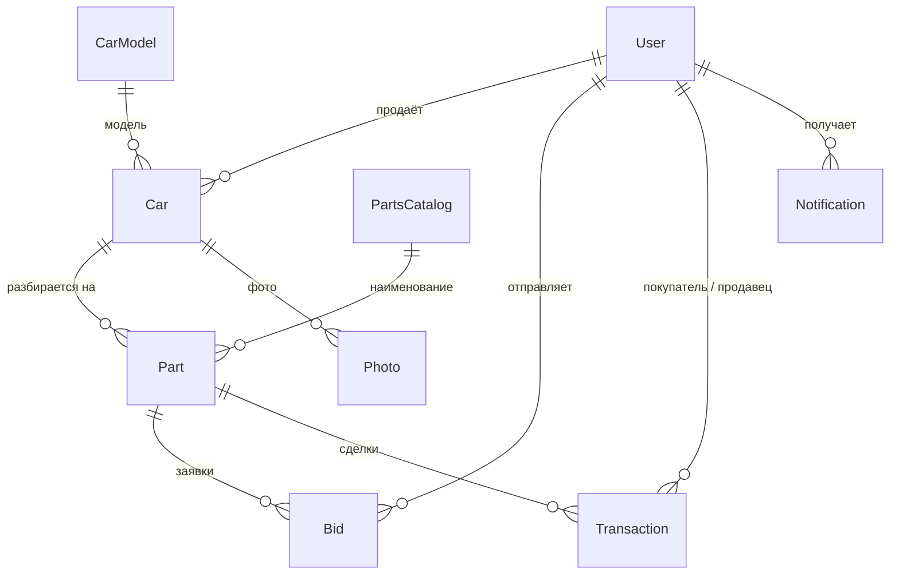

# ZapRu — продажа автомобиля по запчастям

Веб-приложение, в котором владелец старого автомобиля продаёт его по частям. Он размещает машину и список деталей с ценами, а покупатели отправляют заявки со своей ценой на нужные детали. Продавец принимает или отклоняет заявки, после чего стороны получают контакты друг друга.

> Учебный pet-проект, в разработке. Основной сценарий «объявление → заявка → сделка» работает; что ещё не реализовано, описано в разделе [Планы](#планы).


## Возможности

- **Регистрация и вход.** Пароли хранятся только в виде хеша BCrypt, сессия держится на cookie-аутентификации ASP.NET Core.
- **Объявления.** Пользователь размещает автомобиль (модель из справочника, год, пробег, состояние, регион, описание) и перечень запчастей из каталога с ценой и состоянием каждой. Может загрузить фотографии, отредактировать и удалить объявление.
- **Стенды пользователей.** Витрина продавцов с их автомобилями и запчастями, доступными для покупки.
- **Заявки и сделки.** Покупатель предлагает свою цену на деталь и оставляет комментарий. Продавец видит входящие заявки на вкладке «Отклики» и принимает или отклоняет их. Принятая заявка превращается в сделку, а покупатель видит её вместе с контактами продавца на вкладке «Корзина».
- **Уведомления.** Продавец получает уведомление о новой заявке, покупатель — об отказе.
- **Справочники.** Модели автомобилей 15 популярных марок загружаются при запуске из открытого API NHTSA vPIC. Каталог запчастей (28 позиций в 10 категориях) загружается из `parts.json`. Повторный запуск не создаёт дубликатов.

### Бизнес-правила

- Нельзя отправить заявку на свою или на уже проданную деталь.
- Когда продавец принимает заявку, деталь помечается проданной, автомобиль переходит в статус «в сделке», а остальные заявки на эту деталь автоматически отклоняются.
- Объявление с необработанными заявками нельзя удалить. При удалении объявления вместе с ним удаляются файлы фотографий.
- Автомобили, по деталям которых есть необработанные заявки, временно скрываются с витрины.
- Редактировать и удалять можно только свои объявления.

## Стек

| Слой | Технологии |
|---|---|
| Бэкенд | C#, .NET 10, ASP.NET Core MVC и Web API |
| Данные | Entity Framework Core (code-first, миграции), SQLite |
| Безопасность | Cookie-аутентификация ASP.NET Core, BCrypt.Net |
| Фронтенд | Razor-представления, JavaScript (Fetch API), собственные стили CSS |
| Интеграции | NHTSA vPIC API через `HttpClient` |
| Развёртывание | Docker (многоэтапная сборка) |

## Как устроено

Страницы рендерятся Razor-представлениями, а данные они получают и отправляют через REST API на JavaScript (`fetch`). Контроллеры API работают с базой через `DbContext` Entity Framework Core. При запуске приложение само применяет миграции и заполняет справочники.

### Модель данных



## Структура проекта

```
ZapRu/
├── Controllers/    # страницы MVC и REST API
├── Data/           # DbContext и фабрика для миграций
├── Entities/       # сущности предметной области (EF Core)
├── Models/         # модели запросов к API
├── DTOs/NHTSA/     # модели ответа внешнего API
├── Services/       # импорт справочников при запуске
├── Migrations/     # миграции EF Core
├── Views/          # главная, вход и регистрация, витрина, личный кабинет
├── wwwroot/        # стили, скрипты, загруженные фотографии
├── parts.json      # исходный каталог запчастей
└── Dockerfile
```

## API

| Метод | Путь | Назначение | Нужен вход |
|---|---|---|:---:|
| POST | `/api/auth/register` | Регистрация | — |
| POST | `/api/auth/login` | Вход | — |
| POST | `/api/auth/logout` | Выход | — |
| GET | `/api/auth/me` | Текущий пользователь | ✓ |
| GET | `/api/market/users` | Витрина продавцов с автомобилями и запчастями | — |
| GET | `/api/carmodels` | Справочник моделей автомобилей | — |
| GET | `/api/partscatalog` | Каталог запчастей | — |
| GET | `/api/profile/me` | Данные профиля | ✓ |
| GET | `/api/profile/advertisements` | Мои объявления | ✓ |
| POST | `/api/profile/car` | Создать объявление | ✓ |
| PUT | `/api/profile/car/{id}` | Изменить объявление | ✓ |
| DELETE | `/api/profile/car/{id}` | Удалить объявление | ✓ |
| POST | `/api/profile/car/{carId}/photos` | Загрузить фотографии | ✓ |
| POST | `/api/profile/{partId}/bid` | Отправить заявку на деталь | ✓ |
| GET | `/api/profile/bids/received` | Входящие заявки | ✓ |
| POST | `/api/profile/bid/{bidId}/accept` | Принять заявку | ✓ |
| POST | `/api/profile/bid/{bidId}/reject` | Отклонить заявку | ✓ |
| GET | `/api/profile/purchases` | Мои покупки | ✓ |
| GET | `/api/notifications` | Мои уведомления | ✓ |
| POST | `/api/notifications/{id}/respond` | Ответить на уведомление о заявке | ✓ |

## Запуск

**Нужно:** .NET 10 SDK и доступ в интернет при запуске (справочник моделей загружается из NHTSA API).

```bash
git clone https://github.com/Dino-bit388/ZapRu.git
cd ZapRu/ZapRu
dotnet run
```

Приложение откроется на http://localhost:5290. База SQLite создаётся автоматически рядом со сборкой, миграции применяются при старте, справочники заполняются сами — ничего настраивать не нужно.

Можно также открыть `ZapRu.slnx` в Visual Studio или Rider и запустить профиль `http` или `https`.

### Docker

Сборка запускается из корня репозитория:

```bash
docker build -f ZapRu/Dockerfile -t zapru .
docker run -p 8080:8080 zapru
```

Приложение будет доступно на http://localhost:8080.

## Планы

- Расчёт стоимости автомобиля по запчастям: калькулятор на главной странице пока только интерфейс, сущность для оценки уже есть в модели данных.
- Оформление договора купли-продажи по сделке.
- Оплата и завершение сделки.

